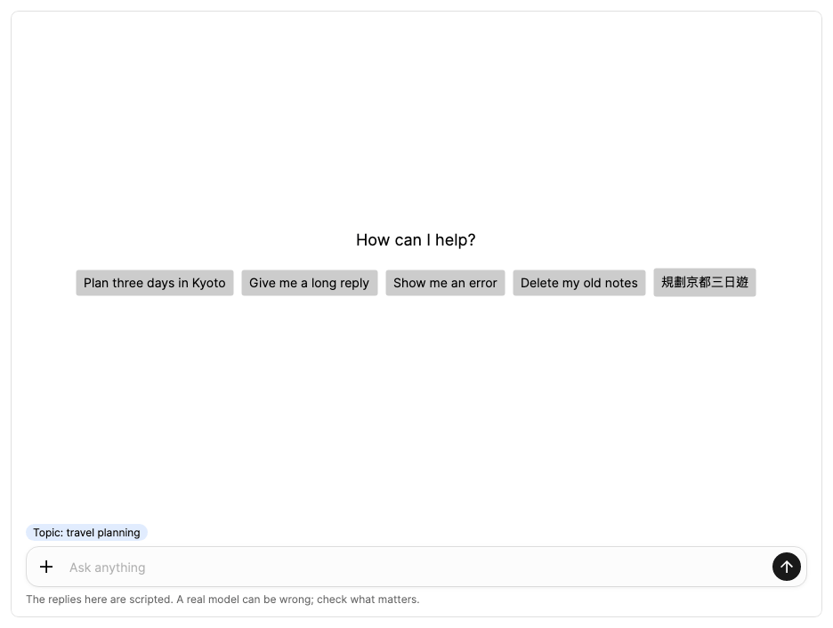

# Polhem.Chat.Avalonia

An AI chat control for Avalonia on top of any [Microsoft.Extensions.AI](https://learn.microsoft.com/dotnet/ai/microsoft-extensions-ai)
`IChatClient`: replies stream in as Markdown, one line shows what the model is doing, and each turn ends with its time
and tokens. It works with the Fluent and Semi themes, light and dark, on the desktop and on mobile.



## Getting started

Add the theme after your base theme:

```xml
<Application xmlns:chat="using:Polhem.Chat.Avalonia" ...>
  <Application.Styles>
    <FluentTheme />
    <chat:ChatTheme />
  </Application.Styles>
</Application>
```

Put a `ChatView` in a window and give it a runner for your client:

```xml
<chat:ChatView x:Name="Chat" />
```

```csharp
Chat.Runner = new ChatRunner(chatClient);   // any IChatClient
```

## Learn more

- [Guide](https://github.com/polhem-dev/polhem-chat/blob/main/docs/en/avalonia.md): running your own loop, images in
  replies, CJK text, templates, texts and colors.
- [ChatGallery sample](https://github.com/polhem-dev/polhem-chat/tree/main/samples/ChatGallery): both ways of using the
  view, with scripted replies that need no key.
- [Changelog](https://github.com/polhem-dev/polhem-chat/blob/main/CHANGELOG.md). The package is at 0.x: a minor version
  may still change the API.
