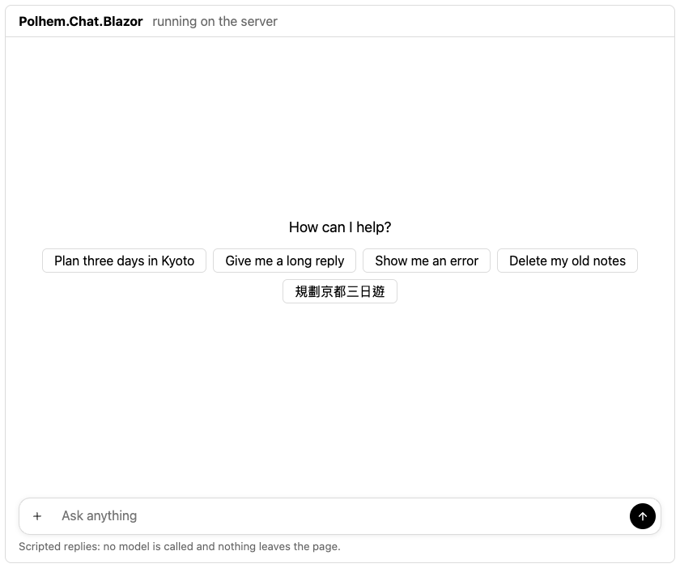

# Polhem.Chat.Blazor

An AI chat component for Blazor on top of any [Microsoft.Extensions.AI](https://learn.microsoft.com/dotnet/ai/microsoft-extensions-ai)
`IChatClient`: replies stream in as Markdown, one line shows what the model is doing, and the user can attach files,
approve tool calls, regenerate and edit. It runs in Interactive Server and WebAssembly, needs no component library,
and follows the page's light or dark colors.



## Getting started

Link the Markdown stylesheet in the page's `<head>`:

```html
<link rel="stylesheet" href="_content/Polhem.Markdown.Blazor/polhem-markdown.css" />
```

Then give a `ChatView` a runner for your client, in an interactive component. The view fills its container's height:

```razor
@using Polhem.Chat
@using Polhem.Chat.Blazor
@inject Microsoft.Extensions.AI.IChatClient ChatClient

<div style="height: 600px">
    <ChatView Runner="runner" />
</div>

@code {
    private ChatRunner runner = null!;

    protected override void OnInitialized() => runner = new ChatRunner(ChatClient);
}
```

**Never put a model API key in a WebAssembly app**: anyone can read it from the downloaded files. Keep the model client
on the server.

## Learn more

- [Guide](https://github.com/polhem-dev/polhem-chat/blob/main/docs/en/blazor.md): Server or WebAssembly, running your
  own loop, attachments, images in replies, theme variables, slots and templates, languages.
- [ChatGallery.Blazor sample](https://github.com/polhem-dev/polhem-chat/tree/main/samples/ChatGallery.Blazor): the same
  component on the server and in the browser, with scripted replies that need no key.
- [Changelog](https://github.com/polhem-dev/polhem-chat/blob/main/CHANGELOG.md). The package is at 0.x: a minor version
  may still change the API.
