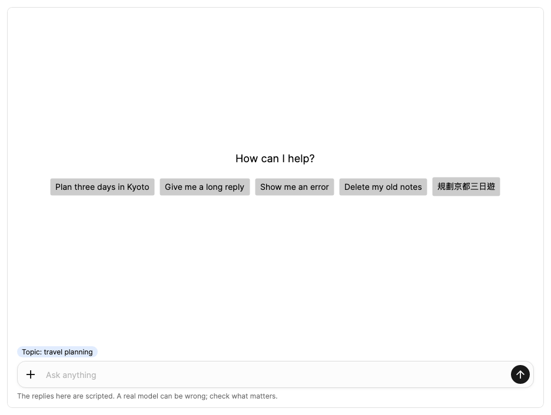

# Polhem.Chat

The conversation model behind the Polhem.Chat controls, on top of any
[Microsoft.Extensions.AI](https://learn.microsoft.com/dotnet/ai/microsoft-extensions-ai) `IChatClient`. It turns streamed
updates into observable entries (text, reasoning, tool calls, usage, errors) and runs each turn with stop, timing and
token counts. It has no UI: add the control for your UI framework, which brings this package with it.

| Package | For |
|---------|-----|
| [Polhem.Chat.Avalonia](https://www.nuget.org/packages/Polhem.Chat.Avalonia) | The chat control for Avalonia |
| [Polhem.Chat.Blazor](https://www.nuget.org/packages/Polhem.Chat.Blazor) | The chat component for Blazor |



## Example

A `ChatRunner` sends a turn, streams it into its `Conversation` and stops it. A view shows the conversation, but the
model works without one:

```csharp
var runner = new ChatRunner(chatClient);   // any IChatClient
await runner.SendAsync("Plan three days in Kyoto");

foreach (var entry in runner.Conversation.Entries)
{
    Console.WriteLine(entry.GetType().Name);   // UserPromptEntry, ToolCallEntry, AssistantReplyEntry…
}
```

To send text the user did not type with a prompt, such as the selected text of a document, add a `PromptContext` in
`MessageSending`. The model receives it before the prompt; a view shows only its label:

```csharp
runner.MessageSending += (_, e) =>
{
    if (!e.ReplacesLastPrompt)   // regenerating and editing send the last prompt's context again
    {
        e.Context.Add(new PromptContext("Selection", editor.SelectedText));
    }
};
```

`Conversation.SaveHistory()` and `LoadHistory(...)` take the history as `Microsoft.Extensions.AI` messages, which the
application stores however it likes; each prompt's context is kept with it.

## Learn more

- [Repository](https://github.com/polhem-dev/polhem-chat): getting started, samples and guides for each control.
- [Changelog](https://github.com/polhem-dev/polhem-chat/blob/main/CHANGELOG.md). The package is at 0.x: a minor version
  may still change the API.
